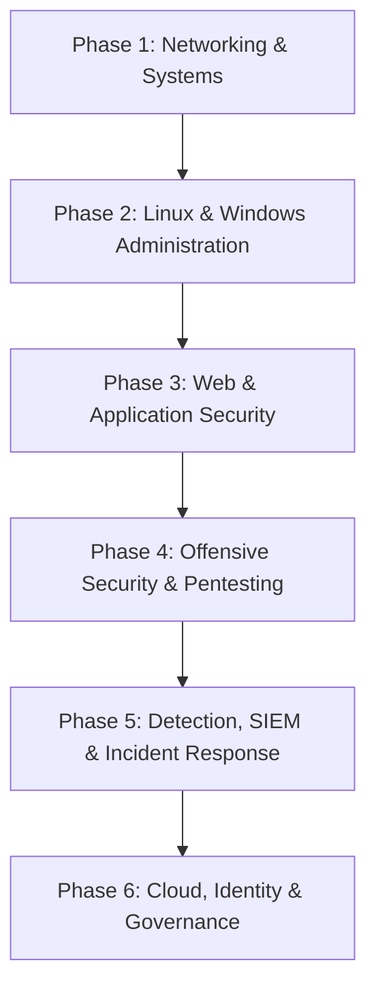

# 🛡️ Cybersecurity Specialist Roadmap

From networking fundamentals to offensive testing, detection engineering, and
security operations — the progression for a Security Analyst, Pentester, or
Security Engineer.

### Phase 1: Networking & Systems Foundations
- **Model**: OSI and TCP/IP layers, encapsulation, MTU/fragmentation, NAT.
- **Protocols**: TCP/UDP, DNS (records, recursion, poisoning), HTTP/1.1–3, TLS 1.2/1.3, ARP, ICMP, BGP basics.
- **Traffic Analysis**: Wireshark/tshark filters, tcpdump, PCAP carving, reading a handshake.
- **Subnetting & Routing**: CIDR math, VLANs, routing tables, firewall rule evaluation order.
- **Weakness Recognition**: Default credentials, unencrypted legacy protocols, flat networks, missing segmentation.

### Phase 2: Linux & Windows Administration
- **Linux**: Permissions and ACLs, `systemd` units, cron, `ss`/`netstat`, package management, log locations (`/var/log`, journald).
- **Windows**: Active Directory objects, GPO, Kerberos/NTLM basics, event log channels, PowerShell fundamentals.
- **Hardening**: CIS Benchmarks, least-privilege accounts, SSH key hygiene, patch cadence.
- **Automation**: Bash and Python for repeatable enumeration and evidence collection.

### Phase 3: Web & Application Security
- **OWASP Top 10**: Broken access control, injection (SQLi/NoSQLi/command), XSS (reflected/stored/DOM), SSRF, insecure deserialization, auth/session flaws.
- **API Security**: OWASP API Top 10, BOLA/BFLA, mass assignment, rate limiting, JWT pitfalls (`alg=none`, `kid` injection).
- **Secure Coding**: Parameterized queries, output encoding, CSRF defenses, Content-Security-Policy, secret management.
- **Tooling**: Burp Suite / ZAP, `sqlmap` in scoped labs, `ffuf`, `nuclei` templates, SAST/DAST triage.

### Phase 4: Offensive Security & Pentesting
- **Methodology**: Scoping and rules of engagement, reconnaissance, enumeration, exploitation, post-exploitation, reporting.
- **Reconnaissance**: Passive OSINT, DNS enumeration (`amass`, `subfinder`), asset discovery, attack-surface mapping.
- **Exploitation**: Metasploit in labs, `nmap` script categories, password attack theory (`hydra`, hashcat modes), payload fundamentals.
- **Privilege Escalation**: Linux (SUID, capabilities, sudo misconfig) and Windows (token privileges, unquoted service paths, AD ACL abuse) in authorized labs only.
- **Reporting**: Executive summary, reproducible findings, CVSS v3.1/v4.0 scoring, remediation guidance.

### Phase 5: Detection, SIEM & Incident Response
- **Telemetry**: Sysmon, auditd, EDR event model, Zeek/Suricata, DNS and proxy logs.
- **SIEM**: Splunk SPL, Elastic KQL/EQL, Sigma rules, detection-as-code with version control.
- **Threat Modelling**: MITRE ATT&CK mapping, kill-chain analysis, purple-team exercises.
- **Incident Response**: NIST 800-61 lifecycle — preparation, identification, containment, eradication, recovery, lessons learned.
- **Forensics**: Chain of custody, disk/memory acquisition order, timeline analysis, volatile evidence handling.

### Phase 6: Cloud, Identity & Governance
- **Cloud Security**: IAM policy evaluation, S3/blob exposure, metadata-service abuse (SSRF → IMDS), VPC segmentation, CSPM.
- **Identity**: SSO/OIDC/SAML flows, MFA enforcement, conditional access, service-account hygiene, secrets rotation.
- **Compliance**: SOC 2, ISO 27001, PCI DSS, GDPR fundamentals and evidence collection.
- **Supply Chain**: SBOM review, dependency pinning, provenance verification, build hardening (SLSA).

### Milestones & Evidence

| Milestone | Evidence you can show |
| :--- | :--- |
| Foundations | Packet-analysis write-up of a captured TLS + DNS session |
| Administration | A hardened Windows or Linux host built against CIS Level 1 |
| AppSec | A triaged vulnerability report with reproduction steps and a fix |
| Offensive | A scoped lab pentest report with CVSS-scored findings |
| Detection | A Sigma rule with a passing test against sample telemetry |
| Cloud | An IAM least-privilege redesign with policy-diff evidence |

### Certifications (optional, not a substitute for evidence)
- Entry: CompTIA Security+, eJPT.
- Offensive: OSCP, PNPT, CRT.
- Defensive/Cloud: GCIH, GCIA, AWS Security Specialty, Azure AZ-500.

### Practice Labs
- [OWASP WebGoat](https://owasp.org/www-project-webgoat/) and [Juice Shop](https://owasp.org/www-project-juice-shop/)
- [Hack The Box](https://www.hackthebox.com/) and [TryHackMe](https://tryhackme.com/)
- [Blue Team Labs Online](https://blueteamlabs.online/) for detection and IR practice

> Only test systems you own or have written authorization to test. Every exercise
> in this repository's `security` skills is scoped to local, disposable labs.
