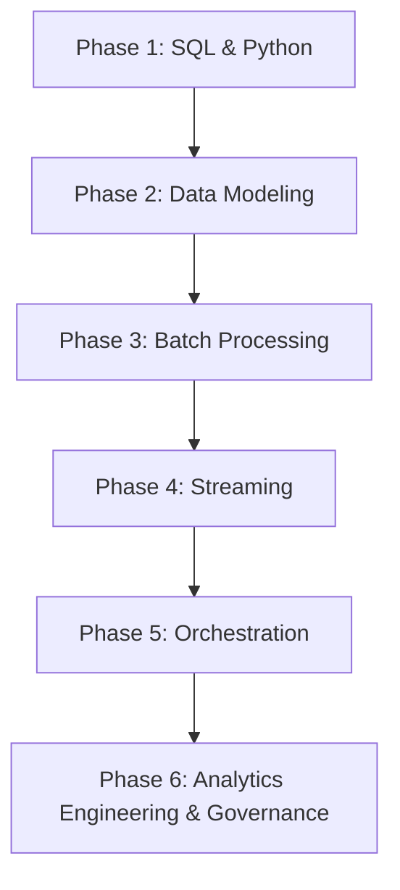

# 🗄️ Data Engineer Roadmap

From SQL and Python foundations to batch/stream pipelines, orchestration, and
analytics engineering.

### Phase 1: SQL & Programming Foundations
- **SQL**: Joins, window functions, CTEs, `EXPLAIN` plans, index usage, transactions and isolation levels.
- **Python**: Type hints, `pathlib`, `dataclasses`, virtual environments, packaging with `pyproject.toml`.
- **Data Formats**: CSV dialect pitfalls, JSON/JSONL, Parquet (columnar, predicate pushdown), Avro and schema evolution.
- **Shell & Git**: Reproducible local runs, branch hygiene, reviewing a data diff.

### Phase 2: Data Modeling
- **Relational**: Normalization (1NF–3NF), keys, constraints, surrogate vs natural keys.
- **Dimensional**: Star and snowflake schemas, slowly changing dimensions (Type 1/2/3), fact-table grain.
- **Wide Tables & Lakehouse**: Denormalization trade-offs, Delta/Iceberg/Hudi table formats, partitioning and clustering.
- **Contracts**: Column types, nullability, freshness SLAs and schema-change policy agreed with consumers.

### Phase 3: Batch Processing
- **Warehouses**: Snowflake, BigQuery, Redshift, ClickHouse — clustering keys, result caching, cost controls.
- **Engines**: Spark DataFrames/SQL, partitioning and shuffle tuning, skew handling, file-size compaction.
- **Ingestion**: Full vs incremental loads, watermarks, idempotent upserts (`MERGE`), late-arriving data.
- **Testing**: Great Expectations/dbt tests, row-count and freshness assertions, fixture datasets.

### Phase 4: Streaming
- **Concepts**: At-least-once vs exactly-once, event time vs processing time, watermarks, windowing (tumbling/sliding/session).
- **Kafka**: Topics, partitions, consumer groups, offset commits, retention, schema registry and compatibility modes.
- **Processing**: Spark Structured Streaming, Flink, Kafka Streams; state stores and checkpointing.
- **Delivery Guarantees**: Dead-letter queues, replay strategy, poison-message handling.

### Phase 5: Orchestration
- **DAG Design**: Idempotent, retry-safe tasks; small units; explicit dependencies.
- **Airflow**: Operators, TaskGroups, sensors vs deferrable operators, pools and SLAs.
- **Alternatives**: Dagster assets, Prefect flows, dbt Cloud jobs, Argo Workflows on Kubernetes.
- **Operations**: Backfills, alerting on failure *and* on silence, runbooks, cost and concurrency limits.

### Phase 6: Analytics Engineering & Governance
- **dbt**: Models, `ref`/`source`, incremental materializations, snapshots, exposures, documentation generation.
- **Semantics**: Metric definitions in one place, tests for uniqueness/not-null/relationships/accepted values.
- **Governance**: Lineage capture, PII classification and masking, retention policy, access reviews.
- **Observability**: Freshness, volume, schema and distribution monitoring with alert routing.

### Milestones & Evidence

| Milestone | Evidence you can show |
| :--- | :--- |
| Foundations | A tuned analytical query with `EXPLAIN` before/after evidence |
| Modeling | A star schema with documented grain and an SCD2 history table |
| Batch | An incremental Spark or warehouse job with idempotent reruns |
| Streaming | A Kafka → consumer pipeline with replay and DLQ demonstration |
| Orchestration | An orchestrated DAG with retries, alerting and a tested backfill |
| Analytics Engineering | A dbt project with tests, docs and lineage for one domain |

### Tooling Cheat Sheet
| Concern | Common choices |
| :--- | :--- |
| Storage | S3/GCS/ADLS, Iceberg/Delta/Hudi |
| Warehouse | Snowflake, BigQuery, Redshift, ClickHouse, DuckDB (local) |
| Batch | Spark, Trino, warehouse-native SQL |
| Streaming | Kafka, Flink, Spark Structured Streaming |
| Orchestration | Airflow, Dagster, Prefect, Argo Workflows |
| Transform | dbt, SQLMesh |
| Quality | dbt tests, Great Expectations, Soda |

### Reference
- [datastacktv/data-engineer-roadmap](https://github.com/datastacktv/data-engineer-roadmap)
- [Data Engineering Zoomcamp](https://github.com/DataTalksClub/data-engineering-zoomcamp)
