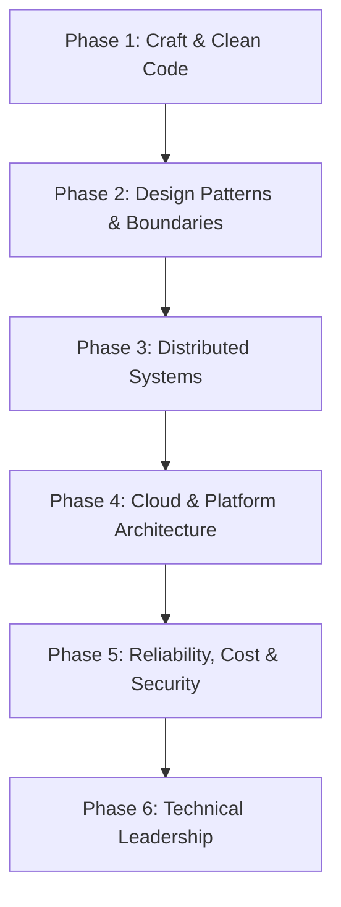

# 🏛️ System Architect / Staff+ Engineer Roadmap

The path from writing good code to owning system-level decisions: boundaries,
distributed systems, cloud architecture, and technical leadership.

### Phase 1: Craft & Clean Code
- **Readability**: Naming, small units, explicit error handling, comments that explain *why*.
- **Testing**: Test pyramid, property-based tests, contract tests, mutation testing to judge suite quality.
- **Refactoring**: Strangler-fig migrations, seams for testability, safe delete-before-add sequencing.
- **Reviewing**: Reviewing for correctness and boundaries, not style; distinguishing blocking from nits.

### Phase 2: Design Patterns & Boundaries
- **SOLID & Composition**: Dependency inversion at module and service level, interface segregation for stable APIs.
- **Domain Modelling**: Bounded contexts, aggregates, invariants, domain events; when CRUD is enough.
- **Modularity**: Layering (domain/application/infrastructure), ports and adapters, anti-corruption layers.
- **Documentation**: Architecture Decision Records (context → decision → consequences), C4 diagrams, threat models.
- **API Design**: Resource modeling, idempotency, pagination, versioning, backward compatibility.

### Phase 3: Distributed Systems
- **Fundamentals**: CAP and PACELC, latency vs throughput, backpressure, queueing theory intuition.
- **Consistency**: Strong vs eventual, read-your-writes, quorum reads/writes, linearizability vs serializability.
- **Time & Ordering**: Logical clocks, idempotency keys, exactly-once illusions, outbox and idempotent consumers.
- **Failure Modes**: Partial failure, retries with jittered backoff, circuit breakers, bulkheads, timeout budgets.
- **Data at Scale**: Partitioning and sharding keys, hot partitions, replication lag, change data capture.
- **Messaging**: Delivery guarantees, ordering scope, schema evolution, dead-letter handling.

### Phase 4: Cloud & Platform Architecture
- **Compute**: Containers vs serverless vs VMs — cold starts, concurrency models, cost per request.
- **Storage**: Object vs block vs file, durability/availability trade-offs, tiering and lifecycle policies.
- **Networking**: VPC design, subnets, private endpoints, ingress/egress control, DNS strategy.
- **Data**: Managed vs self-hosted databases, read replicas, multi-region topology, backup/RTO/RPO.
- **Platform**: Golden paths, IaC (Terraform/Pulumi), environment parity, progressive delivery (canary/blue-green).
- **Kubernetes**: Requests/limits, HPA, PDBs, rollout strategy; knowing when *not* to use it.

### Phase 5: Reliability, Cost & Security
- **SLOs**: SLIs → SLOs → error budgets; alerting on burn rate rather than raw thresholds.
- **Observability**: Structured logs, metrics (RED/USE), distributed tracing, exemplars, cardinality control.
- **Incident Command**: Roles, communication cadence, mitigation before root cause, blameless postmortems.
- **Performance**: Load testing (k6/Gatling), capacity planning, caching layers and invalidation.
- **FinOps**: Unit economics, right-sizing, storage lifecycle, cost attribution by team.
- **Security by Design**: Threat modeling (STRIDE), least privilege, secret rotation, supply-chain provenance.

### Phase 6: Technical Leadership
- **Decision Making**: Writing ADRs, running design reviews, disagree-and-commit, reversible vs irreversible bets.
- **Influence**: Mentoring, scoping work into shippable slices, aligning stakeholders on trade-offs.
- **Roadmapping**: Deprecation plans, migration sequencing, platform adoption metrics.
- **Communication**: One-page designs, RFCs, postmortems, architecture narratives a new hire can follow.

### Milestones & Evidence

| Milestone | Evidence you can show |
| :--- | :--- |
| Craft | A refactor PR with before/after design notes and preserved behavior |
| Boundaries | An ADR that records a real decision and its rejected alternatives |
| Distributed | A design doc for a service with explicit failure-mode analysis |
| Cloud | An IaC-reviewed stack with cost and RTO/RPO estimates |
| Reliability | An SLO with an error-budget policy and a practiced incident runbook |
| Leadership | A design review you facilitated, plus the resulting decision record |

### Reading List
- *Designing Data-Intensive Applications* — Martin Kleppmann
- *Site Reliability Engineering* / *The SRE Workbook* — Google
- *Building Microservices* (2e) — Sam Newman
- *Fundamentals of Software Architecture* — Richards & Ford
- *Release It!* (2e) — Michael Nygard
- *Staff Engineer* — Will Larson

### Repository Anchors
- Skill: [`skills/architecture/architecture-decision-records/`](../skills/architecture/architecture-decision-records/)
- Templates: [`templates/`](../templates/) and [`categories/`](../categories/) deep dives
- Workflows: [`workflows/feature-development.md`](../workflows/feature-development.md)
